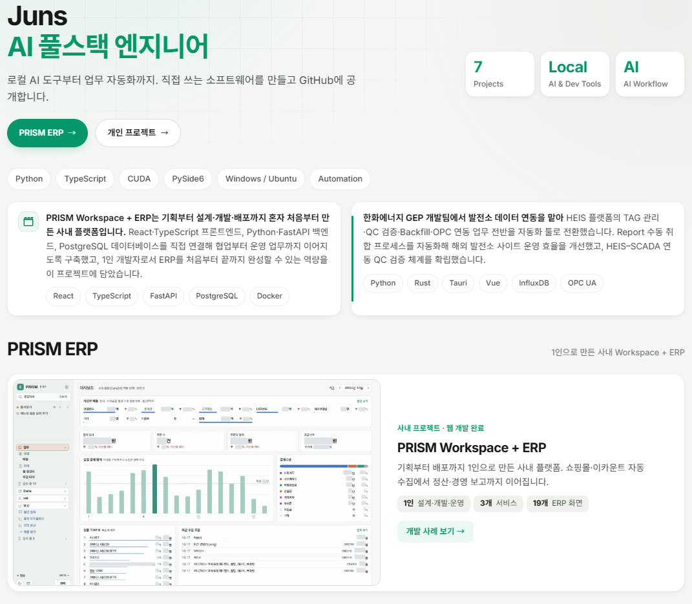

<div align="center">

# Juns — Portfolio

**AI 풀스택 엔지니어 Juns의 개인 포트폴리오**

[](https://juns.win/)
[](#)
[](#)



</div>

<br>

실제 사내 개발 문서(가이드, 인수인계 보고서 등)를 익명화해 개발 과정의 발자취로 기록하고, 진행 중인 오픈소스 프로젝트를 함께 소개하는 **1페이지 포트폴리오**입니다.

## Live

| | |
|---|---|
| **Site** | https://juns.win/ |
| **GitHub Pages** | https://savvy773.github.io/ (juns.win으로 이동) |
| **Repo** | https://github.com/savvy773/savvy773.github.io |

## Highlights

- 프레임워크·빌드 도구 없이 **순수 HTML / CSS / JS** (빌드리스)
- 네이티브 **`<dialog>` + iframe** 모달 — 문서·데모를 페이지 이탈 없이 미리보기
- 카드 전체 클릭으로 GitHub 이동, 별도의 화면·문서 미리보기 링크
- 경력 요약·PRISM ERP 개발 소개, 스킬 스트립, Repositories/Journey 리빌 애니메이션
- PRISM 쇼케이스: 실제 화면 5개를 탭·자동 1회 재생(크로스페이드)으로 보여 줌
- 모던 뉴트럴 테마, 기본 라이트 + 상단 토글로 다크(선택은 브라우저에 저장, 첫 화면부터 적용)
- GPU 절약: idle 시 JS 루프·무한 애니메이션 없음, `prefers-reduced-motion` 전면 대응
- 모바일: safe-area, 터치 hover 완화, 모달 풀스크린
- 분야별 프로젝트 맵: AI 도구·업무 자동화·개발 유틸리티 분포와 필터, 실제 프로젝트 화면 미리보기

## Featured Work

PRISM Workspace + ERP를 혼자 처음부터 설계·React/TypeScript 프론트엔드·FastAPI 백엔드·PostgreSQL 데이터베이스·Docker/Caddy 배포까지 개발해 웹 버전을 완성했습니다. 쇼핑몰·결제·이카운트 자동 수집, 엑셀 Import·Staging 승인, 정산·대사·경영 보고가 운영 중이고 구매·재고·생산·HR은 다음 단계입니다. 원본 소스와 소개 페이지는 비공개입니다.

## Sections

| | |
|---|---|
| **Hero** | 소개·경력 요약·PRISM ERP 개발, 스킬 스트립 |
| **Repositories** | 프로젝트 7개 (비공개 PRISM Workspace + ERP, ai-analysis, ubuntu-scr-saver, web-ai-usage, app-yt-subs, dpi-bye, stt-whisper), GitHub 소스·미리보기 링크 |
| **Journey** | PRISM 1인 구축 사례: 실제 화면(수치·거래처 가림)·완성 기능·설계 포인트·기술 스택, HEIS Tool·OPC-ISL 등 업무 기록 |
| **Resume** | 모달로 바로 보는 이력서 (`resume/resume.html`) |

## Structure

```text
├── content.md          # 콘텐츠 수정 경로 안내
├── index.html          # 마크업·메타
├── css/site.css        # 토큰·카드·반응형
├── js/
│   ├── app.js          # 모달·스크롤·reveal·카드 틸트·업무 기록·쇼케이스 탭
│   └── effects.js      # 비활성 stub (구 Canvas FX 자리, 미로드)
├── assets/thumbs/      # 리포·저니 카드 썸네일 (webp)
├── journey/            # Journey HTML 문서
├── resume/             # 이력서
├── scripts/screenshot.mjs  # README 프리뷰 스샷 캡처
└── docs/tech-stack.md  # 기술 상세
```

## Local

```bash
npx --yes serve .
```

브라우저에서 루트를 열면 됩니다.

CSS·JavaScript 수정 후 게시 전에 `node scripts/version-assets.mjs`를 실행하세요. 파일 내용에 따른 버전을 URL에 붙여 이전 캐시와 새 페이지가 섞이지 않게 합니다.

## Deploy

juns.win은 Cloudflare에 직접 업로드합니다. 커밋한 뒤 `scripts/deploy-cf.sh`를 실행하면 커밋된 HEAD만 올라갑니다(작업 중 파일은 제외). 배포가 끝나면 `scripts/backup-r2.sh`가 git 전체 이력을 R2 버킷 `juns-backup`에 번들로 백업합니다(복원: `git clone latest.bundle`). GitHub는 링크용이고, savvy773.github.io는 juns.win으로 이동만 시킵니다.

## Docs

- [기술 스택 상세](docs/tech-stack.md)

## License

Personal portfolio. Sample / anonymized work docs. © Juns
